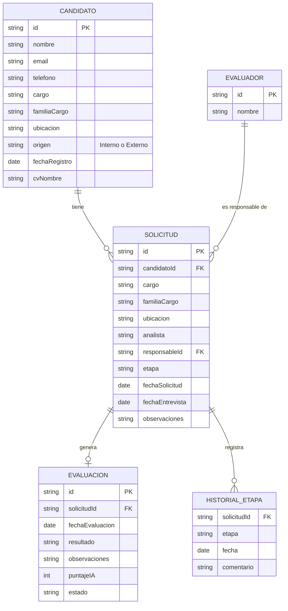

# Avance semana 6: MVP Evaluación Psicolaboral AquaChile

**Asignatura:** DSY1104 Desarrollo Full Stack II, Duoc UC
**Contraparte:** AquaChile, área de Reclutamiento y Selección
**Fecha del avance:** 02/10/2026 (semana 6 de la Carta Gantt)

## 1. Problema

Hoy la evaluación psicolaboral se gestiona en varias herramientas separadas: la solicitud llega por Microsoft Forms, los datos quedan en un Excel, el seguimiento se mueve a mano en un tablero de Planner y los indicadores están en otro dashboard. La psicóloga pierde tiempo en tareas administrativas (mover tarjetas, crear carpetas, copiar información) y no existe un solo lugar donde ver todo el proceso.

## 2. Solución propuesta

Una aplicación web que reúne en un solo sistema:

1. **Formulario público** para que el analista solicite una evaluación (reemplaza el Forms).
2. **Panel (dashboard)** con todas las solicitudes, sus etapas e indicadores, desde donde también se puede registrar un candidato.
3. **Seguimiento por etapas**, con las mismas columnas que hoy usa el Planner: Evaluación recibida → Entrevista agendada → Entrevista realizada → Informe enviado.
4. **Registro de la evaluación** con el resultado que usa el Excel real: Recomendado, Recomendado con observaciones o No recomendado.
5. **Base de datos centralizada** (etapa 2) que alimenta todas las vistas.
6. **Apoyo con IA** (valor agregado): sugerir un puntaje y una categoría a partir de las observaciones de la entrevista. En esta etapa está simulado; la decisión final siempre la toma la psicóloga.

Equivalencia con los estados del anexo: *Pendiente* = Evaluación recibida; *En proceso* = Entrevista agendada o realizada; *Finalizada* = Informe enviado.

## 3. Arquitectura

```
React 18 + Bootstrap 5  →  Backend monolítico (API REST)  →  Base de datos
      (etapa 1, hoy)            (etapa 2, desde S8)            (etapa 2)
```

En esta etapa el frontend funciona con **datos simulados** guardados en un contexto de React (`DataContext`) que persiste en `localStorage`. Todas las vistas leen y escriben datos solo a través de ese contexto; en la etapa 2 se reemplaza el interior de cada acción por llamadas `fetch` a la API sin tocar los componentes.

## 4. Modelo de datos



## 5. Vistas y rutas

| Ruta | Vista | Responsable |
|---|---|---|
| `/` | Panel de evaluaciones (dashboard) | Integrante 1 (Nicolás) |
| `/postular` | Formulario público de solicitud | Integrante 2 |
| `/candidatos` | Listado de candidatos | Integrante 2 |
| `/candidatos/nuevo`, `/candidatos/:id/editar` | Registro y edición de candidato | Integrante 2 |
| `/candidatos/:id` | Ficha del candidato | Integrante 2 |
| `/solicitudes` | Listado de solicitudes con filtros | Integrante 3 |
| `/solicitudes/nueva` | Nueva solicitud | Integrante 3 |
| `/solicitudes/:id` | Detalle, cambio de etapa, evaluación e IA | Integrante 3 |

## 6. Lo que está funcionando hoy

- Proyecto React con Vite, React Router y Bootstrap 5, versionado en GitHub.
- Estructura de carpetas por módulo, datos simulados y validaciones compartidas.
- Estado global con `useReducer` + Context API y persistencia local.
- **Panel completo**: recorrido por etapas que filtra la tabla al hacer clic, indicadores generales, tabla de solicitudes con búsqueda y filtro por familia de cargo, distribución de resultados, carga por evaluador y registro rápido de candidato con validaciones (opcionalmente crea la solicitud).
- Diseño responsive: en celular las etapas pasan a dos columnas, la tabla oculta columnas secundarias y el formulario se abre a pantalla completa.
- Módulos de candidatos y solicitudes en desarrollo por los integrantes 2 y 3, con rutas ya creadas.

## 7. Decisiones técnicas

| Tema | Decisión | Motivo |
|---|---|---|
| Framework | React 18 con Vite | Obligatorio en el anexo; Vite arranca más rápido que CRA |
| Estilos | Bootstrap 5 + CSS propio | Grilla responsive y componentes de formulario listos |
| Estado | Context API + useReducer | Un solo lugar para los datos, fácil de cambiar por la API |
| Backend | *(definir)* Spring Boot / Node.js / PHP | Se decide antes de la semana 8 |
| Base de datos | *(definir)* MySQL / PostgreSQL | Plan gratuito compatible con el backend |
| Pruebas | Jasmine + Karma | Exigido en la rúbrica de la EP2 |

## 8. Próximos pasos

1. Integrar los módulos de candidatos y solicitudes (semana 7).
2. Configurar Jasmine + Karma y escribir al menos 10 pruebas unitarias. Las funciones de `src/utils/dashboard.js`, `src/utils/validaciones.js` y el `dataReducer` ya están separadas para poder probarlas.
3. Redactar el ERS y el documento de cobertura de testing para la EP2.
4. Hito 1, frontend funcional (12 al 17 de octubre).
5. Diseñar el backend monolítico y la base de datos (semana 8 en adelante).
