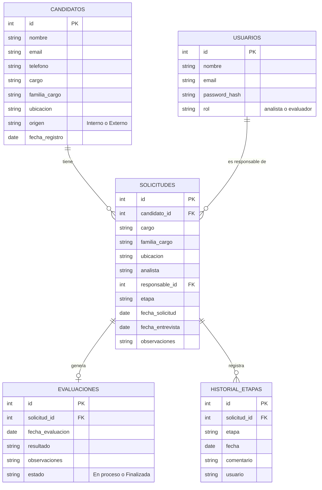

# Avance: MVP Evaluación Psicolaboral AquaChile

**Asignatura:** DSY1104 Desarrollo Full Stack II, Duoc UC
**Contraparte:** AquaChile, área de Reclutamiento y Selección
**Fecha del avance:** 30/10/2026 (entrega AquaChile 1/2)

## 1. Problema

Hoy la evaluación psicolaboral se gestiona en varias herramientas separadas: la solicitud llega por Microsoft Forms, los datos quedan en un Excel, el seguimiento se mueve a mano en un tablero de Planner y los indicadores están en otro dashboard. La psicóloga pierde tiempo en tareas administrativas (mover tarjetas, crear carpetas, copiar información) y no existe un solo lugar donde ver todo el proceso.

## 2. Solución propuesta

Una aplicación web que reúne en un solo sistema:

1. **Formulario público** para que el analista solicite una evaluación (reemplaza el Forms).
2. **Panel (dashboard)** con todas las solicitudes, sus etapas e indicadores, desde donde también se puede registrar un candidato.
3. **Seguimiento por etapas**, con las mismas columnas que hoy usa el Planner: Evaluación recibida → Entrevista agendada → Entrevista realizada → Informe enviado.
4. **Registro de la evaluación** con el resultado que usa el Excel real: Recomendado, Recomendado con observaciones o No recomendado.
5. **Base de datos centralizada** en Supabase que alimenta todas las vistas.
6. **Inicio de sesión con roles**: el analista crea candidatos y solicitudes; el evaluador además registra la evaluación.
7. **Apoyo con IA** (entrega 2/2): sugerir una categoría a partir de las observaciones de la entrevista. La decisión final siempre la toma la psicóloga.

Equivalencia con los estados del anexo: *Pendiente* = Evaluación recibida; *En proceso* = Entrevista agendada o realizada; *Finalizada* = Informe enviado.

## 3. Arquitectura

```
React 18 + Bootstrap 5  →  Backend monolítico Node.js + Express (API REST)  →  PostgreSQL (Supabase)
```

- **Frontend**: React con React Router. Todas las llamadas al backend pasan por `src/services/api.js`, que agrega el token de sesión. Los datos se guardan en un contexto (`DataContext`) para que todas las vistas usen la misma información.
- **Backend**: un solo servidor Express. En desarrollo atiende solo la API; en producción también entrega el frontend compilado, por eso es monolítico y se despliega como un único servicio.
- **Base de datos**: PostgreSQL alojado en Supabase (plan gratuito). El backend se conecta con la cadena de conexión del proyecto.
- **Validaciones**: las mismas funciones de `src/utils/validaciones.js` se usan en los formularios y en la API, así una regla nunca queda distinta entre el front y el back.

## 4. Modelo de datos



## 5. Vistas y rutas

| Ruta | Vista | Acceso |
|---|---|---|
| `/login` | Inicio de sesión | Público |
| `/postular` | Formulario público de solicitud | Público |
| `/` | Panel de evaluaciones (dashboard) | Con sesión |
| `/candidatos` | Listado de candidatos con búsqueda y filtros | Con sesión |
| `/candidatos/nuevo`, `/candidatos/:id/editar` | Registro y edición de candidato | Con sesión |
| `/candidatos/:id` | Ficha del candidato y sus solicitudes | Con sesión |
| `/solicitudes` | Listado de solicitudes con filtros | Con sesión |
| `/solicitudes/nueva` | Nueva solicitud | Con sesión |
| `/solicitudes/:id` | Detalle: asignación, cambio de etapa, evaluación e historial | Con sesión |

## 6. Flujo principal

1. El analista registra al candidato (o llega desde el formulario público).
2. Crea la solicitud de evaluación: queda en **Evaluación recibida**.
3. Asigna un evaluador y la fecha de entrevista, y la pasa a **Entrevista agendada**.
4. Después de la entrevista pasa a **Entrevista realizada** y el evaluador registra el resultado y sus observaciones.
5. Al enviar el informe pasa a **Informe enviado** y la evaluación queda **Finalizada**.
6. El panel muestra en todo momento cuántas solicitudes hay en cada etapa y los indicadores del proceso.

Reglas que valida el backend: solo se avanza o retrocede una etapa a la vez; no se puede agendar sin evaluador ni fecha; no se puede enviar el informe sin una evaluación registrada; solo un evaluador puede registrar la evaluación.

## 7. Decisiones técnicas

| Tema | Decisión | Motivo |
|---|---|---|
| Framework | React 18 con Vite | Obligatorio en el anexo; Vite arranca más rápido que CRA |
| Estilos | Bootstrap 5 + CSS propio con los colores de AquaChile | Grilla responsive y componentes de formulario listos |
| Estado | Context API + useReducer | Un solo lugar para los datos que vienen de la API |
| Backend | Node.js + Express | Mismo lenguaje que el frontend; permite reutilizar las validaciones |
| Base de datos | PostgreSQL en Supabase | Plan gratuito y compatible con el driver `pg` |
| Sesión | JWT con duración de 8 horas | No requiere guardar sesiones en el servidor |
| Pruebas | Vitest + Testing Library + Supertest | Exigido en la rúbrica; Vitest usa la misma configuración de Vite |

## 8. Pendiente para la entrega 2/2

1. Apoyo con IA para sugerir la categoría del evaluado a partir de las observaciones.
2. Ajustes de diseño y nuevas pruebas según la retroalimentación de esta entrega.
